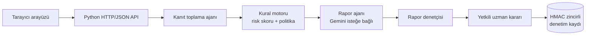

<div align="center">

# ✦ Kredi Karar Sistemi

**Kararı kurallar verir, yapay zekâ anlatır, uzman onaylar.**


**Shining Stars Bitirme Projesi**

</div>

> [!WARNING]
> Bu uygulama banka veya finans kurumu tarafından onaylanmış bir kredi tahsis sistemi **değildir**. Yalnızca sentetik veri ve örnek politika metinleriyle çalışır. Canlı müşteri verisi veya gerçek kredi kararı için kurum onayı, hukuk/mevzuat incelemesi, güvenlik mimarisi ve bağımsız denetim tamamlanmadan kullanmayın.

<!-- Ekran görüntüsü eklemek için: docs/ klasörüne koyup aşağıdaki satırı açın

-->

## İçindekiler

- [Neden bu proje?](#neden-bu-proje)
- [Özellikler](#özellikler)
- [Nasıl çalışır?](#nasıl-çalışır)
- [Hızlı başlangıç (Windows)](#hızlı-başlangıç-windows)
- [Kullanım](#kullanım)
- [Güvenlik](#güvenlik)
- [Üretim yapılandırması](#üretim-yapılandırması)
- [Test](#test)
- [Proje yapısı](#proje-yapısı)
- [Bilinen sınırlar](#bilinen-sınırlar)

## Neden bu proje?

Kredi değerlendirmede üç sorun öne çıkar: benzer profillere tutarsız kararlar, sonradan izlenemeyen gerekçeler ve kararı tamamen bir dil modeline bırakmanın riski.

Bu proje üç ilkeyle yanıt verir:

| İlke | Nasıl uygulanıyor |
| --- | --- |
| **Karar kuraldan gelir** | Risk skoru ve politika önerisi deterministik Python kurallarıyla hesaplanır. |
| **Yapay zekâ yalnızca anlatır** | Gemini isteğe bağlı açıklama metni üretir; rapor denetçisi bu metni kanıtla karşılaştırır. |
| **Son söz uzmanındır** | Nihai karar her zaman yetkili uzmana aittir; her karar denetim zincirine yazılır. |

## Özellikler

- **Başvuru değerlendirme:** Risk skoru, politika kontrolleri ve gerekçe tek ekranda.
- **Portföy analizi:** Toplu risk metrikleri ve sonuçların dışa aktarımı.
- **Karar geçmişi:** Uzman kararı, notu ve denetim zincirinin bütünlük durumu.
- **Güvenli varsayılanlar:** Eksik veya doğrulanmamış veri otomatik onayı kapatır.
- **Gizlilik:** Müşteri adı/kimliği ve kredi/gelir tutarları Gemini'ye gönderilmez.
- **Anahtarsız çalışır:** API anahtarı olmadan örnek veri modu kullanılabilir.

## Nasıl çalışır?



Aynı origin'den sunulan HTML/CSS/JavaScript arayüzü, Python API ve SQLite depolarından oluşur.

## Hızlı başlangıç (Windows)

**Gereksinim:** Python 3.10 veya üzeri. Örnek veritabanı ilk kurulumda üretilir; `.db` dosyaları Git'e eklenmez.

```powershell
python -m venv .venv
.\.venv\Scripts\Activate.ps1
python -m pip install -r requirements.txt
python data/generate_customer_db.py
python manage_users.py add admin --name "Proje Yöneticisi" --role admin
python app.py
```

Ardından tarayıcıda **http://127.0.0.1:8000** adresini açın ve oluşturduğunuz kullanıcı adı (`admin`) ve parola ile giriş yapın.

> [!NOTE]
> - İlk admin hesabı oluşturulmadan sunucu başlamaz.
> - Parola terminalde gizli sorulur (yazarken ekranda görünmez), en az 12 karakter olmalıdır.
> - `Activate.ps1` hata verirse: `Set-ExecutionPolicy -Scope Process Bypass`
> - `data\bank.db` zaten varsa `generate_customer_db.py` hata verir; bu adımı atlayın (`--force` mevcut veriyi silip yeniden üretir).

### İsteğe bağlı: Gemini ile açıklama metni

Anahtarı sunucuyu başlatmadan önce, aynı PowerShell oturumunda tanımlayın:

```powershell
$env:GEMINI_API_KEY = "anahtarınız"
python app.py
```

Anahtarı kaynak koda veya Git'e koymayın; uygulama `.env` dosyası okumaz, yalnızca ortam değişkenlerini kullanır. Model adını `GEMINI_MODEL` ortam değişkeniyle değiştirebilirsiniz. Port çakışırsa `KREDI_PORT` kullanılabilir.

## Kullanım

Rol bazlı hesaplar oluşturabilirsiniz:

```powershell
python manage_users.py add analyst1 --name "Kredi Analisti" --role analyst
python manage_users.py add reviewer1 --name "Kredi Uzmanı" --role reviewer
```

| Komut | Ne yapar? |
| --- | --- |
| `python manage_users.py list` | Hesapları listeler |
| `python manage_users.py disable analyst1` | Hesabı kapatır |
| `python manage_users.py enable analyst1` | Hesabı yeniden açar |
| `python manage_users.py set-role reviewer1 reviewer` | Rolü değiştirir |
| `python manage_users.py reset-password reviewer1` | Parolayı sıfırlar |

Roller: `admin`, `analyst`, `reviewer`. Denetim kayıtlarına yalnızca `reviewer` ve `admin` erişir. Başvuruyu sonuçlandıran uzman, tarayıcının gönderdiği isimden değil, doğrulanmış oturum hesabından alınır.

## Güvenlik

| Alan | Kontrol |
| --- | --- |
| **Kimlik ve oturum** | scrypt ile parola saklama; HttpOnly + SameSite=Strict çerez; üretimde `Secure` çerez |
| **İstek doğrulama** | Yazma isteklerinde CSRF token ve Origin kontrolü |
| **Kötüye kullanım** | Kullanıcı/IP başına giriş sınırı; değerlendirme ve portföy API'lerinde kullanıcı bazlı hız sınırı |
| **Tarayıcı** | Güvenlik başlıkları, katı aynı-origin CSP, istek boyutu sınırı |
| **Denetim izi** | Değiştirilemez event tablosunda HMAC-SHA256 zinciri; karar geçmişi ekranı bütünlüğü gösterir |
| **Yedekleme** | `backup.py` ile AES-256-GCM şifreli SQLite snapshot'ları; `restore_backup.py` canlı DB'nin üzerine yazmaz, bütünlüğü doğrular |
| **Sağlık** | `/healthz` readiness kontrolü |

Veritabanı yolları `KREDI_DATA_DIR` veya ilgili `KREDI_*_DB` değişkenleriyle taşınabilir.

## Üretim yapılandırması

<details>
<summary><b>TLS arkasında çalıştırma ve zorunlu ortam değişkenleri</b></summary>

Uygulama bilerek yalnızca `127.0.0.1` üzerinde dinler ve tek süreçte çalışacak biçimde tasarlanmıştır. İnternete doğrudan port açmayın; TLS sonlandıran bir reverse proxy üzerinden `127.0.0.1:8000` hedefine yönlendirin.

Proxy istemci IP'sini `X-Forwarded-For` başlığında güvenilir biçimde yeniden yazıyorsa proxy IP'sini `KREDI_TRUSTED_PROXY_IPS` içine ekleyin (ör. `127.0.0.1`). Başlığı güvenli biçimde overwrite etmiyorsa bu değişkeni ayarlamayın.

Production için zorunlu değişkenler:

```text
KREDI_ENV=production
KREDI_PUBLIC_ORIGIN=https://uygulama.ornek.com
KREDI_AUDIT_HMAC_KEY=<en az 32 karakter, sabit ve gizli anahtar>
KREDI_BACKUP_ENCRYPTION_KEY=<32 bayt anahtarın URL-safe Base64 kodu>
```

> [!IMPORTANT]
> İki gizli anahtarı veritabanından ayrı, yedekli bir secret manager'da tutun ve döndürme prosedürünü önceden belirleyin. HMAC anahtarı değişirse eski imzalar doğrulanamaz; yedekleme anahtarı kaybolursa şifreli yedekler açılamaz. Anahtarları loglara, ekran görüntülerine veya Git'e koymayın.

Yedek alma ve geri yükleme tatbikatı:

```powershell
python backup.py --output-dir "D:\KrediBackups"
python restore_backup.py "D:\KrediBackups\audit-YYYYMMDDTHHMMSSZ.sqlite.enc" --output-dir "D:\KrediRestoreTest"
```

İlk komut üç DB için şifreli dosyalar üretir; ikincisi örnek olarak tek bir DB'yi yeni klasöre açar. Gerçek tatbikatta müşteri, denetim ve güvenlik veritabanlarının tamamını birlikte geri yükleyip audit zinciri kontrolünü çalıştırın. Yedekleri düzenli zamanlayın ve ayrı, erişim kontrollü bir konuma kopyalayın.

</details>

## Test

```powershell
python -m pytest -p no:cacheprovider tests -q
python -m compileall -q app.py agents tools data manage_users.py backup.py restore_backup.py
node --check web/app.js
Invoke-RestMethod http://127.0.0.1:8000/healthz
```

Testler sentetik DB, geçici hesaplar ve sahte Gemini istemcisi kullanır; canlı Gemini çağrısı yapmaz.

## Proje yapısı

```text
app.py                         HTTP API, oturum/rol kontrolü, uygulama sunucusu
manage_users.py                Hesap ekleme, listeleme, kapatma
backup.py / restore_backup.py  Şifreli DB yedeği ve güvenli test geri yüklemesi
data/security_db.py            Kullanıcılar, parola hash'i, oturum deposu
data/audit_db.py               Karar kayıtları ve HMAC audit zinciri
data/customer_db.py            SQLite müşteri erişimi
agents/                        Kanıt toplama, rapor ve rapor denetçisi
tools/tool_definitions.py      Risk, politika ve portföy kuralları
web/                           Tarayıcı uygulaması
tests/                         API, güvenlik sınırı, bütünlük ve yedek testleri
```

## Bilinen sınırlar

Bu liste, prototipin gerçek kullanıma geçmeden önce kapatılması gereken noktalarını gösterir.

- **Depolama:** SQLite dosyaları uygulama katmanında şifrelenmez. Gerçek veri için şifreli disk/volume, dosya izinleri ve kurumun onayladığı depolama gerekir; şifreli yedekler bunun yerine geçmez.
- **Ölçekleme:** Hız sınırlaması tek süreç belleğindedir. Birden fazla worker/host için merkezi rate-limit, oturum deposu ve PostgreSQL benzeri yönetilen DB gerekir.
- **Denetim zinciri:** HMAC zinciri yerel DB değişikliğini tespit eder; DB silme/rollback veya yöneticinin DB ile anahtar deposuna birlikte erişmesine karşı bağımsız, append-only harici log gerekir.
- **Kurumsal süreç:** Yetki matrisi, resmi ve sürümlenmiş politika, KVKK/mevzuat değerlendirmesi, ayrımcılık/etki analizi, model/veri yönetişimi, sızma testi, olay müdahalesi, izleme ve iş sürekliliği kurum tarafından onaylanmalıdır.
- **Gemini:** Canlı Gemini bağlantısı, sağlayıcı tarafında anahtarla doğrulanana kadar doğrulanmış sayılmaz.

## Ekip

**Shining Stars** Sedef Akşin